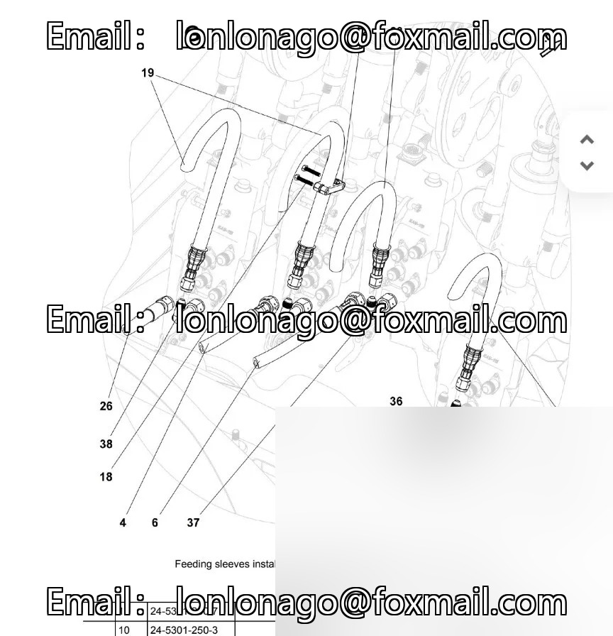
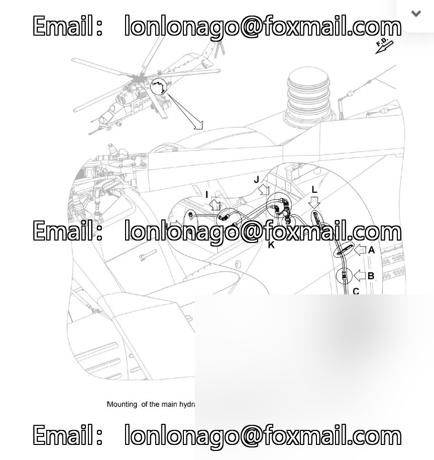
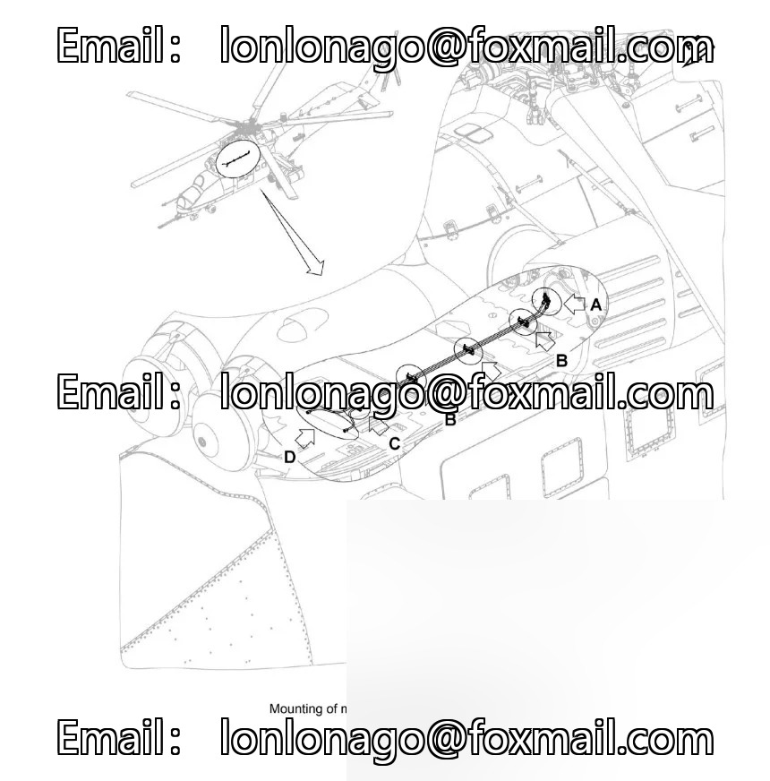

# Russian Mi-35M hydraulic system design materials

## Body

Russia Mi-35M hydraulic system design material: Russia Mi-35M helicopter hydraulic system (Hydraulic System) parts/components catalog (Parts Catalog) PDF file, 100 pages.
Design material/source files, covering related parts numbers, installation positions, system layout, etc., suitable for maintenance, modification, and technical reference.
901584
non-refundable upon sale.

The material covers a Russian Mi-35M hydraulic system parts catalog with component numbers, installation locations and layout; it comprises 100 pages and includes identifier 901584.

<!-- AI_ENRICHED -->

## Images

## Payment

Here is a pay link on Stripe ( https://buy.stripe.com/3cs8yP7sY87d0vu9AB ). Please contact me lonlonago@foxmail.com after funding $89, and I will send you a complete data files , thank you!

